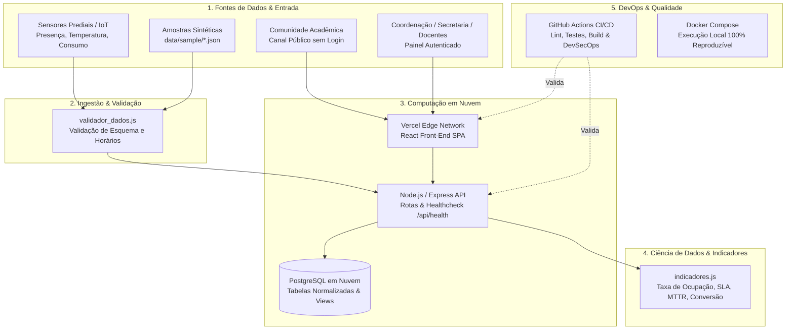

# 🏢 SGA — Sistema de Gestão de Ambientes
> **Organização • Controle • Eficiência • Nuvem • Ciência de Dados • DevOps**

[](https://github.com/edilainesolde/SGA/actions/workflows/ci.yml)
[](https://nodejs.org/)
[](https://react.dev/)
[](https://supabase.com/)
[](LICENSE)

---

## 👥 Integrantes da Equipe TechFlow

| Foto | Nome | GitHub | Função no Projeto |
|:---:|---|---|---|
|  | **Vitor Fazano** | [@vfazano](https://github.com/vfazano) | Engenharia de Dados, DevOps, CI/CD e Indicadores |
|  | **Fabio Bitencourt** | [@fabiobitencourt93](https://github.com/fabiobitencourt93) | Back-End, API Express e Integração Supabase |
|  | **Guilherme Leite** | [@guilhermeleiteads](https://github.com/guilhermelleiteads) | Front-End React, UX/UI, Atribuições e Alocações |
|  | **Ronaldo Soares** | [@ronaldorfas](https://github.com/ronaldorfas) | Infraestrutura, Vercel, Docker e Observabilidade |
|  | **Edilaine Paulino** | [@edilainesolde](https://github.com/edilainesolde) | Front-End, Canal Público, Cadastros e Gestão Ágil |
|  | **Bianca Cirilo** | [@biancaciriloads](https://github.com/biancaciriloads) | Qualidade, Modelagem Relacional e Casos de Uso |

---

## 📚 Documentação Obrigatória do Projeto

| Documento | Formato Obrigatório | Fonte Editável | Descrição |
|---|:---:|:---:|---|
| **Plano do Projeto Integrador II** | 📄 [**Baixar PDF**](docs/plano-projeto-integrador-ii.pdf) | 📝 [Markdown](docs/plano-projeto-integrador-ii.md) | Plano completo com DevOps, Ciência de Dados, Nuvem e Evidências |
| **Relatório Acadêmico (Mini TCC)** | 📄 [**Baixar PDF**](docs/relatorio-academico-mini-tcc.pdf) | 📝 [Markdown](docs/relatorio-academico-mini-tcc.md) | Mini TCC no formato ABNT (Frameworks Front-End) |
| **Decisões Arquiteturais (ADRs)** | 🏛️ [Acessar ADRs](docs/decisoes/) | — | Registros de justificativa técnica, custos, riscos e dados |
| **Casos de Uso e Diagramas** | 📘 [Visualizar Casos de Uso](Diagramas/SGA_Casos_de_Uso.md) | — | Diagramas UML, regras de negócio e fluxos de atores |

---

## 🎯 1. O Problema e o Valor Entregue

Em instituições de ensino, o acompanhamento de salas de aula, laboratórios, auditórios e solicitações de reparo é frequentemente conduzido por meio de planilhas eletrônicas desconexas. Isso provoca:
1. **Conflito de horários** em salas entre turmas e docentes;
2. **Subutilização de laboratórios** e desperdício de energia elétrica com salas climatizadas vazias;
3. **Lentidão no atendimento a chamados de manutenção** (ar-condicionado, projetor, iluminação);
4. **Ausência de métricas** de tempo médio de solução (MTTR) e taxa de ocupação dos espaços físicos.

O **SGA** resolve essas dores centralizando todo o ciclo operacional em uma aplicação web integrada, oferecendo:
* **Canal Público de Manutenção (Sem Login):** Qualquer pessoa da comunidade acadêmica pode reportar uma avaria por smartphone;
* **Triagem e Validação:** Separação estrita entre sugestão pública e ordem de serviço oficial;
* **Reserva com Prevenção de Conflito:** Bloqueio automático para salas com status "Ocupada" ou "Em Manutenção";
* **Painel Analítico:** Indicadores de Ciência de Dados com fórmulas auditáveis para apoio à tomada de decisão.

---

## 🏛️ 2. Arquitetura da Solução e Fluxo de Dados



---

## 📈 3. Indicadores de Ciência de Dados

O SGA calcula e monitora **4 indicadores estratégicos** com fórmulas matemáticas implementadas em [`data_science/indicadores.js`](data_science/indicadores.js):

| Indicador | Fórmula Matemática | Fonte dos Dados | Interpretação & Ação Gerencial |
|---|---|---|---|
| **1. Taxa de Ocupação de Ambientes (TOA)** | $\frac{\sum \text{Horas Semanais Alocadas}}{\text{Horas Úteis da Grade}} \times 100$ | `alocacoes_ambiente`, `turmas`, `ambientes` | $\ge 85\%$ indica saturação; $< 50\%$ indica ociosidade, permitindo remanejamento de turmas. |
| **2. Taxa de Cumprimento de SLA** | $\frac{\text{Chamados Concluídos no Prazo}}{\text{Total de Chamados Concluídos}} \times 100$ | `sugestoes_manutencao` (`finalizado_em`, `sla_horas_limite`) | Meta $\ge 90\%$. Taxas baixas apontam gargalos no atendimento da infraestrutura física. |
| **3. MTTR (Tempo Médio de Reparo)** | $\frac{\sum (\text{Finalização} - \text{Aprovação Triagem})}{N}$ | `sugestoes_manutencao` (`analisado_em`, `finalizado_em`) | Mede em horas a agilidade técnica após validação, expurgando o tempo de espera da triagem. |
| **4. Taxa de Conversão de Sugestões** | $\frac{\text{Sugestões Aprovadas na Triagem}}{\text{Total de Sugestões Avaliadas}} \times 100$ | `sugestoes_manutencao` (`status`) | Avalia a acurácia dos alertas enviados pela comunidade acadêmica no canal público. |

---

## ⚡ 4. Como Executar o Projeto Localmente

### Opção A: Execução Determinística com Docker Compose (Recomendada)
Para levantar o banco PostgreSQL local, o backend Express e o frontend React com um único comando:

```bash
# 1. Clonar o repositório
git clone https://github.com/edilainesolde/SGA.git
cd SGA

# 2. Inicializar os contêineres
docker compose up -d --build

# 3. Acessar a aplicação:
# - Front-End Web: http://localhost:3000
# - Backend API: http://localhost:3001/api/health
# - Banco PostgreSQL: localhost:5432 (database: sga_db, user: sga_user)
```

Para encerrar os serviços:
```bash
docker compose down -v
```

---

### Opção B: Execução Manual com Node.js

#### 1. Backend (API REST)
```bash
cd APP/beck_end
cp .env.example .env
npm install
npm run dev
```
A API estará ativa em `http://localhost:3001` (Healthcheck: `http://localhost:3001/api/health`).

#### 2. Front-End (React SPA)
```bash
cd APP/font_end
npm install
npm start
```
A aplicação abrirá no navegador em `http://localhost:3000`.

---

## 🧪 5. Automação de Testes e Validação de Dados

Na raiz do repositório, execute os scripts de automação:

```bash
# 1. Executa a validação de esquema e integridade dos dados sintéticos:
npm run validate-data

# 2. Executa a suíte de 13 testes unitários automatizados:
npm test

# 3. Executa todo o fluxo de CI localmente:
npm run ci
```

### Resultados dos Testes Automatizados:
```
✔ Indicador 1: Taxa de Ocupação - cálculo correto
✔ Indicador 1: Taxa de Ocupação - validação de limites e divisão por zero
✔ Indicador 2: Taxa de Cumprimento de SLA - cálculo correto
✔ Indicador 3: MTTR (Tempo Médio de Reparo) - cálculo em horas
✔ Indicador 4: Taxa de Conversão de Sugestões em Ocorrências
✔ Regra de Reserva - Permite reserva apenas se sala estiver Disponível/LIVRE
✔ Regra de Triagem - Separação estrita entre sugestão pública e ocorrência oficial
✔ Validação de Ambientes - deve aprovar dados válidos
✔ Validação de Ambientes - deve rejeitar capacidade negativa ou zero
✔ Validação de Ambientes - deve rejeitar código duplicado
✔ Validação de Turmas - deve rejeitar horário final anterior ao inicial
✔ Validação de Alocações - deve detectar conflito de horário no mesmo ambiente
✔ Validação de Manutenção - deve rejeitar status desconhecido
ℹ tests 13 | pass 13 | fail 0
```

---

## 🏭 6. Extensão Opcional — Automação Industrial e Telemetria IoT (Bônus)

O SGA integra um simulador de sensores IoT prediais para monitoramento em tempo real:
* **Sensores Simulados:** Presença (PIR HC-SR501), Temperatura Ambiente (DHT22) e Consumo Elétrico (SCT-013);
* **Executar Simulação de Telemetria:**
  ```bash
  node automation/simulador_sensores.js
  ```
* **Massa de Dados Sintéticos de Sensores:** [`data/sample/telemetria_sensores.json`](data/sample/telemetria_sensores.json);
* **Isolamento e Segurança:** A extensão opera estritamente com dados sintéticos sem conexão física de risco a máquinas pesadas.

---

## 🔄 7. Roteiro de Observabilidade e Recuperação de Falhas (Runbook)

* **Healthcheck do Sistema:** O endpoint `GET /api/health` retorna `200 OK` atestando conectividade ativa com a nuvem;
* **Recuperação de Falha Front-End (Vercel):** No painel da Vercel &rarr; *Deployments* &rarr; selecionar versão anterior estável &rarr; *Instant Rollback*;
* **Recuperação de Falha no Repositório (Git):** Executar `git revert <commit-hash>` e push para reativar o pipeline de CI;
* **Restauração de Dados (Supabase):** Utilização do recurso nativo de Point-in-Time Recovery no painel do Supabase.

---

## 📋 8. Checklist de Verificação dos Requisitos de Entrega

- [x] `docs/plano-projeto-integrador-ii.pdf` existe, abre e está legível;
- [x] Fonte editável `docs/plano-projeto-integrador-ii.md` versionada e atualizada;
- [x] Relatório acadêmico Mini TCC ABNT `docs/relatorio-academico-mini-tcc.md` e PDF gerado;
- [x] Registros de Decisões Arquiteturais em `docs/decisoes/` (ADR-001 a ADR-005);
- [x] Conjunto de dados sintéticos em `data/sample/` (JSON, CSV e validador);
- [x] Quatro indicadores de Ciência de Dados com fórmula matemática e interpretação documentada;
- [x] Suíte de testes automatizados em `tests/` com aprovação contínua no GitHub Actions;
- [x] Configuração reproduzível via `docker-compose.yml` e Dockerfiles;
- [x] Separação de credenciais via `.env.example` sem tokens versionados;
- [x] Extensão de automação industrial opcional integrada e documentada em `automation/`.

---

**Equipe TechFlow — Projeto Integrador II & Frameworks Front-End — 2026**
