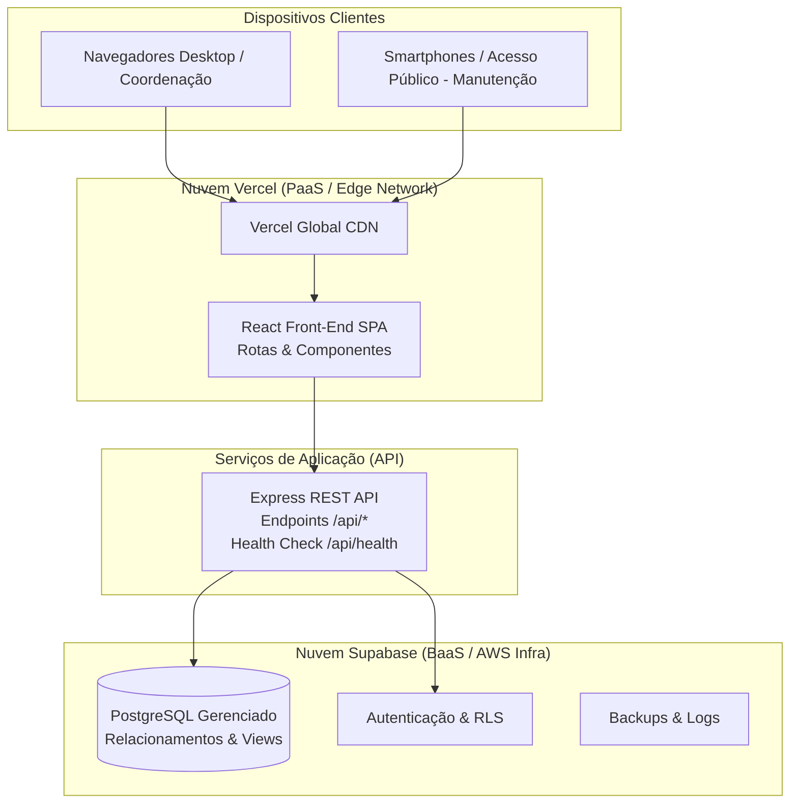

# ☁️ Módulo de Computação em Nuvem — SGA

O **SGA (Sistema de Gestão de Ambientes)** foi arquitetado seguindo o paradigma moderno de **Computação em Nuvem Híbrida e Serverless/PaaS**, garantindo alta disponibilidade, segurança, escalabilidade automática e baixo custo operacional.

---

## 🏛️ Topologia e Arquitetura em Nuvem

---

## 🌐 Componentes da Nuvem

### 1. Camada de Apresentação (Vercel)
- **Hospedagem:** Vercel Edge Network com distribuição geográfica e cache estático;
- **Protocolo de Segurança:** HTTPS / TLS 1.3 nativo com renovação automática de certificados;
- **Roteamento SPA:** Arquivo [`APP/font_end/vercel.json`](../APP/font_end/vercel.json) configurado com regras de reescrita (`rewrites`) para suportar navegação client-side sem erros 404;
- **Integração Git:** Deploy contínuo ativado automaticamente com preview branches para testes.

### 2. Camada de Dados e Persistência (Supabase)
- **Engine:** PostgreSQL 15+ em nuvem (região AWS us-east-1);
- **Segurança e Criptografia:** Dados criptografados em repouso (AES-256) e em trânsito (SSL/TLS obrigatório);
- **Políticas de Governança:** Separação estrita de credenciais:
  - `SUPABASE_ANON_KEY`: Utilizada para operações públicas restritas;
  - `SUPABASE_SERVICE_ROLE_KEY`: Utilizada exclusivamente pelo backend Express via variáveis de ambiente seguras.

### 3. Camada de Middleware e API (Node.js / Express)
- Responsável pelo isolamento das regras de negócio, cálculo dos indicadores de ciência de dados e healthcheck;
- Executável tanto como serviço em nuvem (Render, Railway, Fly.io ou Vercel Serverless Functions) quanto localmente via Docker.

---

## 🔐 Configuração de Variáveis de Ambiente em Nuvem

Para configurar a aplicação em provedores de nuvem sem expor credenciais no repositório:

| Variável | Descrição | Onde Configurar | Exemplo |
|---|---|---|---|
| `PORT` | Porta de escuta da API | Backend / Container | `3001` |
| `NODE_ENV` | Modo de execução | Backend / Frontend | `production` |
| `SUPABASE_URL` | URL da instância Supabase | Painel do Provedor | `https://xxxx.supabase.co` |
| `SUPABASE_SERVICE_ROLE_KEY` | Chave de serviço secreta | Secrets do Backend | `eyJhbGciOi...` |

---

## 🧭 Roteiro de Demonstração em Nuvem

1. **Acesso Público:** Acessar a URL de demonstração do SGA na Vercel;
2. **Envio de Solicitação Pública:** Navegar até `Sugerir Manutenção`, preencher os dados de uma sala de teste e submeter sem login;
3. **Painel de Triagem da Manutenção:** Efetuar login como perfil Manutenção, validar que a sugestão aparece com status `PENDENTE_ANALISE`, realizar a aprovação e observar a atualização do status para `APROVADA`;
4. **Verificação de Healthcheck da API:** Acessar o endpoint `/api/health` para comprovar a comunicação ativa com o banco em nuvem.
