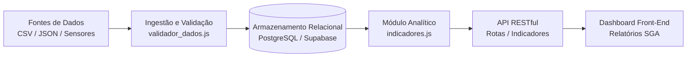

# 📊 Módulo de Ciência de Dados — SGA

O módulo de **Ciência de Dados** do SGA é responsável pelo ciclo completo de vida dos dados educacionais e de infraestrutura: desde a ingestão e validação de qualidade até a transformação analítica e cálculo de indicadores estratégicos para tomada de decisão.

---

## 🔄 Fluxo de Dados (Data Pipeline)



1. **Fontes de Dados:** Amostras sintéticas e registros transacionais contínuos (`ambientes`, `turmas`, `alocacoes`, `sugestoes_manutencao`, `telemetria_sensores`).
2. **Ingestão e Validação:** Processo automatizado que rejeita inconsistências (sobreposição de horários, capacidades negativas, IDs órfãos).
3. **Tratamento e Normalização:** Carga relacional no banco com chaves estrangeiras e índices analíticos.
4. **Cálculo de Indicadores:** Fórmulas estatísticas e operacionais executadas via rotas ou consultas agregadas.
5. **Apresentação:** Visualização no painel administrativo para a Coordenação, Secretaria e Setor de Manutenção.

---

## 📈 Indicadores Chave de Desempenho (KPIs)

O SGA implementa e documenta formalmente **4 indicadores fundamentais**:

### 1. Taxa de Ocupação dos Ambientes Físicos ($TOA$)

* **Objetivo:** Identificar salas e laboratórios ociosos ou sobrecarregados por turno e período letivo.
* **Fórmula Matemática:**
  $$\text{Taxa de Ocupação (\%)} = \left( \frac{\sum \text{Horas Semanais Efetivamente Alocadas}}{\text{Horas Úteis Disponíveis na Grade Semanal}} \right) \times 100$$
* **Fonte dos Dados:** Tabelas `alocacoes_ambiente`, `turmas` e `ambientes` (`data/sample/alocacoes.json`).
* **Interpretação e Ação Gerencial:**
  - **$\ge 85\%$:** Ambiente em saturação. Necessidade de expansão de turmas em outros horários ou salas extras.
  - **$60\% - 84\%$:** Faixa de utilização ideal e sustentável.
  - **$< 50\%$:** Ociosidade crônica. Possibilidade de realocação de turmas para economia de energia elétrica e ar-condicionado.

---

### 2. Taxa de Cumprimento de SLA de Manutenção ($T_{SLA}$)

* **Objetivo:** Medir a pontualidade e eficácia do setor de infraestrutura no atendimento de ocorrências dentro da janela contratada/pactuada.
* **Fórmula Matemática:**
  $$\text{SLA (\%)} = \left( \frac{\text{Quantidade de Ocorrências Finalizadas Dentro do Prazo}}{\text{Total de Ocorrências Finalizadas com SLA Válido}} \right) \times 100$$
* **Fonte dos Dados:** Tabela `sugestoes_manutencao` (campos `finalizado_em`, `analisado_em` e `sla_horas_limite`).
* **Interpretação e Ação Gerencial:**
  - **$\ge 90\%$:** Alta eficiência do setor de manutenção preventiva e corretiva.
  - **$< 75\%$:** Gargalo operacional. Exige contratação de terceiros ou remanejamento de técnicos de manutenção.

---

### 3. MTTR — Mean Time To Repair (Tempo Médio de Reparo em Horas)

* **Objetivo:** Avaliar a rapidez média para diagnosticar, executar e homologar o reparo de um problema validado.
* **Fórmula Matemática:**
  $$\text{MTTR (horas)} = \frac{\sum_{i=1}^{N} \left( \text{Timestamp Finalização}_i - \text{Timestamp Aprovação Triagem}_i \right)}{N}$$
  *Onde $N$ é o total de ocorrências finalizadas.*
* **Fonte dos Dados:** Tabela `sugestoes_manutencao` (`criado_em`, `analisado_em`, `finalizado_em`).
* **Interpretação e Ação Gerencial:**
  - A separação entre o momento da sugestão pública e o momento da triagem garante que o MTTR meça **apenas o tempo de ação técnica**, evitando distorções decorrentes de solicitações paradas em triagem.

---

### 4. Taxa de Conversão de Sugestões em Ocorrências ($T_{CSO}$)

* **Objetivo:** Medir a qualidade e a relevância das comunicações enviadas pelo público geral sem login.
* **Fórmula Matemática:**
  $$\text{Taxa de Conversão (\%)} = \left( \frac{\text{Sugestões Aprovadas na Triagem}}{\text{Total de Sugestões Avaliadas}} \right) \times 100$$
* **Fonte dos Dados:** Tabela `sugestoes_manutencao` (`status`).
* **Interpretação e Ação Gerencial:**
  - **Alta ($\ge 80\%$):** O público está consciente e informando problemas reais com descrições precisas.
  - **Baixa ($< 40\%$):** Há excesso de alertas falsos, comunicações duplicadas ou falta de clareza nas instruções do formulário público.

---

## 🧪 Validação e Testes Automatizados

O cálculo matemático dos indicadores possui cobertura total de testes automatizados executados na esteira de CI/CD:
```bash
# Executa a suíte de testes de indicadores
node --test tests/indicadores.test.js
```
O código fonte dos cálculos está implementado em [`data_science/indicadores.js`](indicadores.js).
