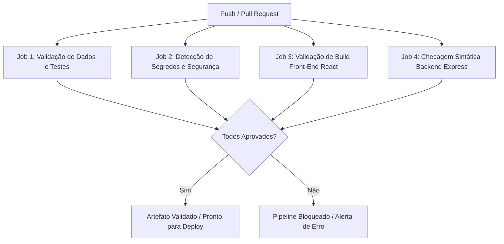

# ♾️ Módulo de DevOps & Qualidade de Software — SGA

Este documento detalha as práticas, ferramentas, automações e políticas de **DevOps** empregadas no desenvolvimento e na sustentação do **SGA (Sistema de Gestão de Ambientes)**, assegurando uma entrega contínua, reprodutível, auditável e segura.

---

## 🛠️ Pilares de DevOps Adotados

1. **Automação Contínua (CI/CD):** Validação de cada alteração de código por meio de pipelines no GitHub Actions.
2. **Ambiente Reproduzível:** Execução determinística local via `docker-compose.yml` e contêineres Docker.
3. **Qualidade e Testes:** Testes automatizados de validação de dados, cálculos estatísticos e regras de negócio.
4. **Segurança (DevSecOps):** Detecção automática de segredos em commits e segregação de credenciais via `.env`.
5. **Observabilidade e Resiliência:** Monitoramento de saúde da API (`/api/health`), logs estruturados e procedimento documentado de recuperação/rollback.

---

## 🚀 Pipeline de Integração Contínua (GitHub Actions)

O pipeline está configurado no arquivo [`.github/workflows/ci.yml`](../.github/workflows/ci.yml) e é disparado a cada `push` ou `pull request` nos ramos `main`, `develop` e `develop-2`.

### Etapas da Esteira:



* **Job 1 (Validação e Testes):** Instala Node.js, executa `npm run validate-data` (garante esquema e integridade referencial dos dados sintéticos) e roda `npm test` (13 cenários de teste automatizados).
* **Job 2 (Segurança):** Verifica se arquivos sensíveis (`.env`, certificados ou chaves) foram incluídos indevidamente no versionamento.
* **Job 3 (Front-End Build):** Compila a aplicação React em ambiente de produção simulado, validando bundle e ausência de erros de sintaxe JSX.
* **Job 4 (Backend Check):** Valida dependências e integridade sintática dos scripts Node/Express.

---

## 🐳 Execução Reproduzível com Docker Compose

Para garantir que o SGA possa ser avaliado ou executado em qualquer máquina sem dependência de configurações prévias:

```bash
# 1. Clonar o repositório
git clone https://github.com/edilainesolde/SGA.git
cd SGA

# 2. Inicializar o ecossistema completo (Banco PostgreSQL + Backend + Front-End)
docker compose up -d --build

# 3. Acessar os serviços:
# - Front-End Web: http://localhost:3000
# - Backend API: http://localhost:3001/api/health
# - PostgreSQL: localhost:5432 (banco: sga_db, user: sga_user)
```

Para encerrar o ambiente e liberar portas:
```bash
docker compose down -v
```

---

## 🩺 Observabilidade & Health Check

O backend disponibiliza um endpoint oficial de verificação de disponibilidade:
* **Rota:** `GET /api/health`
* **Exemplo de Resposta Saudável (200 OK):**
```json
{
  "ok": true,
  "storage": "supabase",
  "timestamp": "2026-11-03T22:30:00Z"
}
```
* **Exemplo de Falha de Conexão (503 Service Unavailable):**
```json
{
  "ok": false,
  "storage": "not-configured",
  "erro": "Configure SUPABASE_URL e SUPABASE_SERVICE_ROLE_KEY no .env do backend."
}
```

---

## 🔄 Roteiro de Recuperação de Incidentes e Rollback (Runbook)

Em caso de falha após a publicação de uma nova versão:

### Cenário 1: Falha na Camada Front-End (Vercel)
1. Acesse o painel da **Vercel** > Projeto `SGA` > Aba **Deployments**;
2. Localize a última versão com status verde (anterior ao incidente);
3. Clique em **Instant Rollback** para reativar o deployment estável em menos de 10 segundos.

### Cenário 2: Falha no Repositório Git / Código Backend
1. Identifique o hash do commit problemático através de `git log --oneline`;
2. Crie um commit de reversão:
   ```bash
   git revert <hash-do-commit>
   git push origin main
   ```
3. O pipeline de CI será disparado automaticamente, revalidando os testes e publicando o código restaurado.

### Cenário 3: Falha no Banco de Dados (Supabase / PostgreSQL)
1. Conecte ao painel do Supabase > **Database** > **Backups**;
2. Selecione o ponto de restauração (Point-in-Time Recovery) anterior ao erro;
3. Execute o script de validação de integridade [`data/sample/validador_dados.js`](../data/sample/validador_dados.js) para certificar a consistência dos registros.
