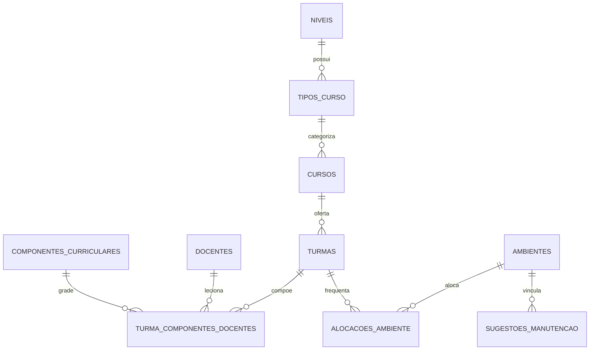
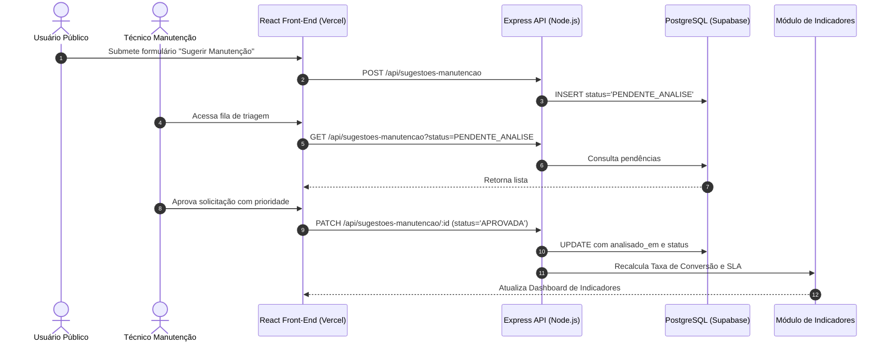

# Plano de Execução e Evidências do Projeto Integrador II
## Escopo Temático: DevOps, Ciência de Dados e Computação em Nuvem

---

**Projeto:** SGA — Sistema de Gestão de Ambientes  
**Equipe:** TechFlow  
**Instituição:** Curso Superior de Tecnologia em Análise e Desenvolvimento de Sistemas  
**Semestre:** 2º Semestre Letivo  
**Data:** Novembro de 2026 — Versão Final 1.1.0  
**Repositório Oficial:** [github.com/edilainesolde/SGA](https://github.com/edilainesolde/SGA)  
**Documento Obrigatório:** `docs/plano-projeto-integrador-ii.pdf` (gerado a partir deste arquivo editável)

---

### Integrantes da Equipe TechFlow

| Nome | Função Principal no Projeto | Atribuições Específicas |
|---|---|---|
| **Vitor Fazano** | Engenharia de Dados & DevOps | Pipeline de CI/CD, testes automatizados e modelagem de indicadores |
| **Fabio Bitencourt** | Back-End & Arquitetura | Desenvolvimento da API REST Express e integração Supabase |
| **Guilherme Leite** | Front-End & UX/UI | Componentização React, telas de alocação e atribuição de aulas |
| **Ronaldo Soares** | Infraestrutura & Nuvem | Provisionamento Vercel, Docker Compose e observabilidade |
| **Edilaine Paulino** | Front-End & Gestão de Backlog | Telas de cadastro, canal público de manutenção e testes de usabilidade |
| **Bianca Cirilo** | Qualidade & Documentação | Modelagem relacional, diagramas de casos de uso e validação de dados |

---

## 1. Etapa 1 — Definição do Problema, Usuário e Escopo

### 1.1. Contexto e Formulação do Problema
Em instituições de ensino técnico e superior, a gestão de espaços físicos (salas de aula, laboratórios especializados de informática e redes, auditórios e salas de reuniões) constitui um desafio operacional crítico. Frequentemente, as informações sobre turmas, alocações de horários, disponibilidade de salas e ocorrências de infraestrutura encontram-se **fragmentadas em planilhas eletrônicas desconexas, mensagens de e-mail e formulários impressos**.

Esse modelo manual acarreta sérios prejuízos:
1. **Conflito de Alocações:** Docentes e turmas direcionados para o mesmo ambiente no mesmo dia e horário;
2. **Ociosidade e Ineficiência Energética:** Salas climatizadas e iluminadas permanecem vazias durante turnos inteiros por falta de visibilidade em tempo real;
3. **Lentidão e Extrapolação de SLA na Manutenção:** Falhas como lâmpadas queimadas, vazamentos, computadores danificados ou aparelhos de ar-condicionado defeituosos demoram dias para chegar ao conhecimento da equipe técnica;
4. **Ausência de Métricas e Inteligência Estratégica:** A coordenação acadêmica não dispõe de indicadores confiáveis sobre a taxa de ocupação dos ambientes ou a eficácia dos reparos para fundamentar decisões de expansão e orçamento.

### 1.2. Usuários e Partes Interessadas (Stakeholders)
* **👔 Coordenação de Curso:** Necessita atribuir disciplinas a docentes, vincular turmas e alocar ambientes físicos sem sobreposição de horários, além de analisar relatórios de utilização;
* **🗂️ Secretaria Acadêmica:** Realiza o cadastro de docentes, turmas e cursos, emitindo relatórios operacionais;
* **👨‍🏫 Corpo Docente:** Consulta suas alocações semanais e realiza reservas de salas/laboratórios para aulas práticas ou eventos acadêmicos;
* **🔧 Equipe de Manutenção / Infraestrutura:** Recebe sugestões públicas, realiza a triagem técnica, valida a procedência do problema, abre ordens de serviço e acompanha o cumprimento dos prazos contratuais de atendimento (SLA);
* **🌐 Comunidade Acadêmica (Público Geral):** Qualquer aluno, visitante ou funcionário que identifique uma anomalia em uma sala e deseja comunicá-la de forma ágil, diretamente pelo smartphone, **sem necessidade de login ou cadastro prévio**.

### 1.3. Perguntas que a Solução Responde
1. *Qual é a taxa de ocupação de cada ambiente físico por turno e dia da semana?*
2. *Quais ambientes estão em manutenção ou livres no momento exato em que um docente precisa de uma reserva emergencial?*
3. *Qual é o percentual de ocorrências de manutenção solucionadas dentro do SLA pactuado (< 48h)?*
4. *Qual é o Tempo Médio de Reparo (MTTR) das ocorrências de infraestrutura após a validação técnica?*

### 1.4. Delimitação do Escopo

#### Escopo Principal (MVP Validado):
- Ingestão e validação contínua de dados de ambientes, turmas, alocações e ocorrências;
- Persistência em banco de dados relacional normalizado (PostgreSQL hospedado em nuvem via Supabase);
- API RESTful intermediária desenvolvida em Node.js e Express com endpoint de health check;
- Aplicação Front-End Web responsiva em React.js com navegação SPA;
- Módulo público de envio de sugestões de manutenção e módulo administrativo de triagem;
- Automação completa de testes unitários, validação de esquema de dados e pipeline de CI/CD (GitHub Actions);
- Execução local 100% reproduzível via contêineres Docker (`docker-compose.yml`);
- Implantação e demonstração em ambiente de computação em nuvem (Vercel e Supabase).

#### O que Fica Fora do Escopo no Semestre:
- Hardware físico real de leitores RFID em cada porta da instituição (substituído pela simulação e checklist patrimonial por sala);
- Módulo de folha de pagamento ou cobrança financeira de mensalidades de alunos;
- Atuação física direta em disjuntores ou maquinário de alta potência sem operador humano.

### 1.5. Critérios de Aceite Formais
- **CA-01:** Ao importar ou cadastrar registros válidos de ambientes e turmas, as informações persistem no banco relacional e ficam disponíveis para consulta em tempo real;
- **CA-02:** Um registro com horário final menor ou igual ao horário inicial, capacidade de sala negativa/nula ou código duplicado é imediatamente rejeitado com registro explícito da causa;
- **CA-03:** O sistema impede a reserva de qualquer ambiente cujo status seja "Ocupada" ou "Em Manutenção";
- **CA-04:** Uma sugestão pública de manutenção só é contabilizada como ocorrência oficial e incluída nas métricas de MTTR após aprovação formal na triagem técnica;
- **CA-05:** O repositório executa toda a suíte de testes e validação de dados de forma automática a cada alteração de código via GitHub Actions;
- **CA-06:** O ambiente pode ser levantado localmente com o comando `docker compose up -d` e possui endpoint `/api/health` para verificação de integridade.

---

## 2. Etapa 2 — Planejamento de Dados e Arquitetura

### 2.1. Origem, Formato, Volume e Qualidade dos Dados
* **Origem dos Dados:** Arquivos sintéticos e históricos gerados pela instituição (`data/sample/ambientes.json`, `turmas.json`, `alocacoes.json`, `sugestoes_manutencao.json`) e formulários transacionais preenchidos em tempo real pelos usuários na aplicação web;
* **Formato:** Arquivos JSON estruturados e exportações tabulares em CSV para interoperabilidade;
* **Volume:** Na fase de homologação, catálogos contendo dezenas de salas, centenas de alocações semanais e registros contínuos de manutenção;
* **Regras de Qualidade e Limpeza:**
  - Rejeição de valores nulos em chaves primárias e estrangeiras;
  - Validação de integridade referencial: uma alocação obrigatoriamente referencia um `ambiente_id`, `turma_id` e `docente_id` existentes;
  - Restrição temporal: `horario_fim > horario_inicio` e datas no padrão ISO 8601 (`YYYY-MM-DD`).

### 2.2. Modelo de Armazenamento Relacional (PostgreSQL)
A base de dados do SGA foi projetada seguindo as normas da terceira forma normal (3FN):



* **`ambientes`:** id, codigo (único), nome, tipo, local, capacidade, status ('Disponível', 'Ocupada', 'Em Manutenção');
* **`turmas`:** id, curso_id, codigo (único), nome, turno, carga_horaria, horario_inicio, horario_fim, situacao;
* **`docentes`:** id, registro (único), nome, area;
* **`alocacoes_ambiente`:** id, ambiente_id, turma_id, docente_id, dia_semana, horario_inicio, horario_fim;
* **`sugestoes_manutencao`:** id, ambiente_id, solicitante, descricao, tipo_ocorrencia, prioridade, status ('PENDENTE_ANALISE', 'APROVADA', 'NAO_APROVADA', 'EM_ATENDIMENTO', 'FINALIZADA'), criado_em, analisado_em, finalizado_em, sla_horas_limite, sla_cumprido.

### 2.3. Fluxo de Dados Ponta a Ponta



---

## 3. Etapa 3 — Implementação, Versionamento e Qualidade

### 3.1. Práticas de Versionamento e Gestão de Código
* Repositório centralizado no GitHub com branch padrão `main` e fluxo de trabalho baseado em branches de desenvolvimento (`develop`, `develop-2`);
* Commits semânticos e rastreáveis descrevendo o propósito de cada incremento funcional;
* Proibição expressa de credenciais em código através de `.gitignore` rigoroso e validação automatizada em CI.

### 3.2. Estrutura de Diretórios do Repositório
```
SGA/
├── .github/workflows/ci.yml       # Pipeline automatizado de CI/CD
├── .env.example                   # Modelo seguro de variáveis de ambiente
├── docker-compose.yml             # Orquestração local do ambiente
├── package.json                   # Scripts de automação (npm test, validate-data)
├── README.md                      # Documentação técnica e guia do avaliador
├── docs/                          # Documentação técnica e acadêmica
│   ├── plano-projeto-integrador-ii.md  # Fonte editável deste documento
│   ├── plano-projeto-integrador-ii.pdf # PDF obrigatório do plano e evidências
│   ├── relatorio-academico-mini-tcc.md # Mini TCC ABNT (Frameworks Front-End)
│   └── decisoes/                  # Architectural Decision Records (ADRs 001 a 005)
├── data/sample/                   # Conjuntos de dados sintéticos e validador
│   ├── ambientes.json (.csv)
│   ├── turmas.json (.csv)
│   ├── alocacoes.json (.csv)
│   ├── sugestoes_manutencao.json (.csv)
│   ├── telemetria_sensores.json
│   └── validador_dados.js         # Script de validação de qualidade de dados
├── tests/                         # Suíte de testes automatizados
│   ├── validacao_dados.test.js    # Testes de integridade de dados sintéticos
│   ├── indicadores.test.js        # Testes das fórmulas de Ciência de Dados
│   └── regras_negocio.test.js     # Testes de reservas e triagem de manutenção
├── infra/                         # Artefatos de infraestrutura Docker
│   ├── Dockerfile.backend
│   ├── Dockerfile.frontend
│   └── init-db.sql
├── data_science/                  # Módulo de indicadores e algoritmos
├── automation/                    # Simulador IoT predial (Bônus Opcional)
├── cloud/                         # Documentação de arquitetura de nuvem
├── devOps/                        # Documentação de CI/CD e observabilidade
└── APP/                           # Código-fonte da aplicação
    ├── Banco_de_dados/            # Schemas DDL e scripts SQL do Supabase
    ├── beck_end/                  # API REST Node.js / Express
    └── font_end/                  # Aplicação Web React.js (SPA)
```

---

## 4. Etapa 4 — Automatização da Entrega e Nuvem (DevOps & Cloud)

### 4.1. Esteira de CI/CD no GitHub Actions
A esteira configurada em [`.github/workflows/ci.yml`](../.github/workflows/ci.yml) executa 4 jobs simultâneos e independentes a cada `push`:
1. **Validação de Qualidade de Dados:** Executa `npm run validate-data` que analisa os arquivos em `data/sample/` contra o validador formal;
2. **Execução de Testes Automatizados:** Roda `npm test`, garantindo que todas as 13 asserções de validação de dados, indicadores matemáticos e regras de negócio passem com 100% de sucesso;
3. **Auditoria de Segurança:** Busca proativamente por arquivos sensíveis `.env` comitados acidentalmente;
4. **Verificação de Build do Front-End:** Garante que a compilação do React na Vercel não falhará em produção.

### 4.2. Topologia em Nuvem e Deploy
* **Front-End:** Hospedado na nuvem global da **Vercel**, provendo entrega estática via CDN Edge com baixa latência, certificado SSL automático e suporte a rotas SPA configurado no [`APP/font_end/vercel.json`](../APP/font_end/vercel.json);
* **Banco de Dados:** Hospedado no **Supabase** (PostgreSQL 15 em nuvem com criptografia de dados em repouso e em trânsito);
* **Health Check & Observabilidade:** Endpoint `GET /api/health` retorna status `200 OK` e confirma o pool de conexões com o banco em nuvem;
* **Procedimento de Rollback:** Em caso de anomalia, o recurso de *Instant Rollback* da Vercel reativa a versão anterior em menos de 10 segundos, enquanto a restauração do banco é feita pelo painel de *Point-in-Time Recovery* do Supabase.

---

## 5. Etapa 5 — Análise de Dados, Indicadores e Demonstração

### 5.1. Fórmulas e Interpretação dos Indicadores

#### Indicador 1: Taxa de Ocupação de Ambientes ($TOA$)
* **Fórmula:**
  $$\text{Taxa de Ocupação (\%)} = \left( \frac{\sum \text{Horas Semanais com Aula Alocada}}{\text{Capacidade Horária Total do Ambiente}} \right) \times 100$$
* **Fonte dos Dados:** Tabelas `alocacoes_ambiente` e `ambientes` (`data/sample/alocacoes.json`);
* **Aplicação Prática:** Permite à coordenação identificar salas com menos de 50% de ocupação para remanejamento de turmas, gerando economia com climatização e energia elétrica.

#### Indicador 2: Taxa de Cumprimento de SLA de Manutenção ($T_{SLA}$)
* **Fórmula:**
  $$\text{SLA (\%)} = \left( \frac{\text{Ordens de Manutenção Concluídas Dentro do Prazo}}{\text{Total de Ordens de Manutenção Concluídas}} \right) \times 100$$
* **Fonte dos Dados:** Tabela `sugestoes_manutencao` (`finalizado_em`, `analisado_em`, `sla_horas_limite`);
* **Aplicação Prática:** Assegura que falhas de alta prioridade (ex: ar-condicionado com vazamento sobre equipamentos de informática) sejam resolvidas em menos de 24 horas.

#### Indicador 3: MTTR — Mean Time To Repair (Tempo Médio de Reparo)
* **Fórmula:**
  $$\text{MTTR (horas)} = \frac{\sum (\text{Timestamp Conclusão} - \text{Timestamp Validação Triagem})}{\text{Total de Ocorrências Atendidas}}$$
* **Aplicação Prática:** Mede exclusivamente o tempo de atuação da equipe técnica, desconsiderando o tempo em que a sugestão pública esteve aguardando triagem.

#### Indicador 4: Taxa de Conversão de Sugestões em Ocorrências ($T_{CSO}$)
* **Fórmula:**
  $$\text{Taxa de Conversão (\%)} = \left( \frac{\text{Sugestões Aprovadas na Triagem}}{\text{Total de Sugestões Avaliadas}} \right) \times 100$$
* **Aplicação Prática:** Avalia a acurácia das informações enviadas pela comunidade acadêmica pelo canal público.

---

## 6. Extensão Opcional — Automação Industrial e Telemetria IoT (Bônus)

Para cumprir o item de **Automação Industrial Opcional (Bônus de até 10%)**, o SGA integrou um modelo de telemetria predial inteligente:
* **Sensores Simulados:**
  1. Sensor de Presença Infravermelho Passivo (PIR) para aferição de ocupação física real;
  2. Sensor de Temperatura e Umidade (DHT22) para diagnóstico preditivo de falhas de climatização;
  3. Sensor de Corrente Elétrica Não-Invasivo (SCT-013) para medição de consumo ativo (Watts).
* **Simulador Autônomo:** Script [`automation/simulador_sensores.js`](../automation/simulador_sensores.js) capaz de produzir lotes de telemetria com geração de alertas automáticos quando a temperatura ultrapassa 26.5°C ou há detecção de consumo pico.
* **Segurança e Isolamento:** A simulação opera isolada de equipamentos industriais pesados, garantindo segurança total e sem risco operacional à infraestrutura.

---

## 7. Roteiro de Demonstração Passo a Passo para os Avaliadores

Para que a banca avaliadora comprove a execução ponta a ponta da solução:

1. **Validação Automática dos Dados e Testes:**
   ```bash
   npm run ci
   ```
   *Evidência:* O validador atesta a conformidade de 100% dos registros sintéticos e a suíte de testes unitários conclui 13 testes com status APROVADO.

2. **Simulação de Telemetria de Sensores IoT:**
   ```bash
   node automation/simulador_sensores.js
   ```
   *Evidência:* Tabela estruturada no terminal exibindo status de presença, temperatura e consumo elétrico por sala.

3. **Submissão de Sugestão Pública (Sem Login):**
   - Acesse a interface web do SGA;
   - Clique em **"Sugerir Manutenção"** no canto superior da tela inicial;
   - Selecione a sala `LAB-201`, descreva o problema ("Projetor não liga") e submeta o formulário;
   - O sistema confirma o envio e gera um registro com status `PENDENTE_ANALISE`.

4. **Triagem Técnica pelo Setor de Manutenção:**
   - Efetue login com perfil de manutenção;
   - Acesse a tela de **Direcionamento de Manutenção**;
   - Visualize a sugestão recém-enviada, atribua prioridade "Alta", aprove a solicitação e confirme a conversão para `APROVADA`.

5. **Verificação de Healthcheck e Logs em Nuvem:**
   - Acesse o endpoint `/api/health`;
   - O retorno `{ "ok": true, "storage": "supabase" }` comprova a saúde e conectividade do ecossistema em nuvem.

---

## 8. Retrospectiva, Limitações e Trabalhos Futuros

### 8.1. Principais Desafios Enfrentados
* **Separação de Perfis e Permissões:** Garantir que o canal público pudesse submeter ocorrências sem comprometer tabelas acadêmicas sensíveis do Supabase;
* **Conflitos de Horários:** Modelar consultas analíticas capazes de detectar sobreposições de intervalos de tempo na alocação de salas;
* **Isolamento de Credenciais em CI:** Configuração da esteira de automação no GitHub Actions garantindo que nenhum secret de produção fosse exposto nos logs públicos de build.

### 8.2. Propostas de Melhorias Futuras
1. Integração com leitores físicos de RFID/NFC nos batentes das salas para registro automático de presença de docentes;
2. Algoritmo de Inteligência Artificial para recomendação ótima de alocação de salas minimizando o deslocamento dos alunos;
3. Envio de notificações automáticas via webhook/WhatsApp para a equipe de manutenção assim que uma ocorrência crítica for aprovada.

---

**Equipe TechFlow — Projeto Integrador II — DevOps, Ciência de Dados e Computação em Nuvem**
