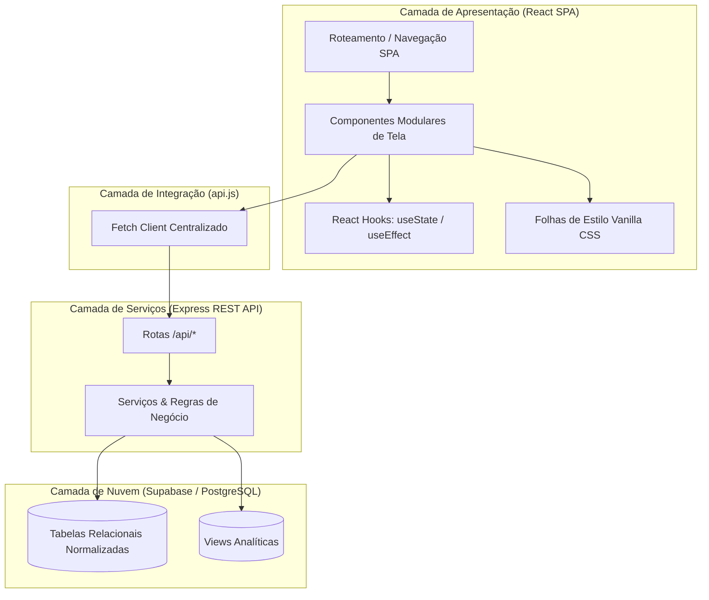

# INSTITUIÇÃO DE ENSINO SUPERIOR
## CURSO SUPERIOR DE TECNOLOGIA EM ANÁLISE E DESENVOLVIMENTO DE SISTEMAS
### DISCIPLINA: FRAMEWORKS FRONT-END

\vspace{3cm}

# SISTEMA DE GESTÃO DE AMBIENTES (SGA)
## DESENVOLVIMENTO DE UMA APLICAÇÃO WEB REATIVA COM REACT.JS, ARQUITETURA SPA E SUPABASE

\vspace{4cm}

**EQUIPE TECHFLOW:**
* Bianca Cirilo
* Edilaine Paulino
* Fabio Bitencourt
* Guilherme Leite
* Ronaldo Soares
* Vitor Fazano

\vspace{3cm}

**SÃO PAULO — SP**  
**2026**

---

\newpage

# SISTEMA DE GESTÃO DE AMBIENTES (SGA)
## DESENVOLVIMENTO DE UMA APLICAÇÃO WEB REATIVA COM REACT.JS, ARQUITETURA SPA E SUPABASE

\vspace{3cm}

**Trabalho de Conclusão de Disciplina (Mini TCC)** apresentado ao Curso Superior de Tecnologia em Análise e Desenvolvimento de Sistemas da Instituição, como requisito parcial para obtenção de nota na disciplina de **Frameworks Front-End** e **Projeto Integrador II**.

**Docente Responsável:** Professor Orientador da Disciplina  
**Equipe de Desenvolvimento:** TechFlow  

\vspace{4cm}

**SÃO PAULO — SP**  
**2026**

---

\newpage

## RESUMO

O presente trabalho acadêmico documenta o planejamento, a modelagem, a implementação e a validação do **SGA — Sistema de Gestão de Ambientes**, uma aplicação web reativa desenvolvida para solucionar os problemas de fragmentação de informações na administração de espaços físicos em instituições de ensino. O cenário pré-existente caracterizava-se pelo uso de planilhas eletrônicas e controles manuais desarticulados, culminando em conflitos de horários em salas de aula, subutilização de laboratórios e lentidão no atendimento a chamados de manutenção predial. Para sanar tais vulnerabilidades, desenvolveu-se uma aplicação baseada na biblioteca **React.js**, estruturada segundo o paradigma de *Single Page Application* (SPA), com divisão modular de componentes, gerenciamento centralizado de estado por meio de *React Hooks* e consumo de API RESTful conectada ao banco de dados relacional gerenciado **Supabase** (PostgreSQL). A solução contempla perfis de acesso diferenciados para Coordenação, Secretaria, Docentes e Equipe de Manutenção, além de disponibilizar um canal público e responsivo para que qualquer membro da comunidade acadêmica possa comunicar falhas de infraestrutura diretamente de dispositivos móveis sem autenticação. O processo de desenvolvimento apoiou-se na metodologia ágil Kanban, no versionamento colaborativo com Git/GitHub, em práticas de engenharia de software com testes automatizados e em esteiras de integração contínua (CI/CD) no GitHub Actions, com deploy contínuo na nuvem da Vercel. Os resultados obtidos evidenciam ganho significativo na agilidade operacional, eliminação de duplicidades de reserva e transparência nos indicadores de governança.

**Palavras-chave:** Frameworks Front-End. React.js. Single Page Application. Gestão de Ambientes. Supabase. DevOps.

---

## ABSTRACT

This academic paper documents the planning, modeling, implementation, and validation of the **SGA — Environment Management System**, a reactive web application developed to solve the problems of information fragmentation in the administration of physical spaces in educational institutions. The pre-existing scenario was characterized by the use of electronic spreadsheets and disjointed manual controls, resulting in scheduling conflicts in classrooms, underutilization of laboratories, and delays in addressing building maintenance requests. To remedy these vulnerabilities, an application based on the **React.js** library was developed, structured according to the Single Page Application (SPA) paradigm, with modular component separation, centralized state management using React Hooks, and RESTful API consumption connected to the **Supabase** managed relational database (PostgreSQL). The solution includes role-based access for Academic Coordination, Administration, Faculty, and Maintenance Team, in addition to providing a responsive public channel where any member of the academic community can report infrastructure flaws directly from mobile devices without authentication. The development process was supported by the agile Kanban methodology, collaborative versioning with Git/GitHub, software engineering practices with automated testing, and continuous integration (CI/CD) pipelines in GitHub Actions, with continuous deployment to the Vercel cloud. The results obtained demonstrate a significant gain in operational agility, the elimination of duplicate reservations, and transparency in governance indicators.

**Keywords:** Front-End Frameworks. React.js. Single Page Application. Facility Management. Supabase. DevOps.

---

\newpage

## SUMÁRIO

1. **INTRODUÇÃO**
   - 1.1. Contextualização
   - 1.2. Formulação do Problema
   - 1.3. Justificativa
   - 1.4. Objetivos
     - 1.4.1. Objetivo Geral
     - 1.4.2. Objetivos Específicos
2. **FUNDAMENTAÇÃO TEÓRICA**
   - 2.1. Evolução das Aplicações Web e o Paradigma SPA
   - 2.2. O Ecossistema React.js e o Virtual DOM
   - 2.3. Componentização e Gerenciamento de Estado com Hooks
   - 2.4. Consumo de APIs RESTful e Backend-as-a-Service (Supabase)
   - 2.5. Acessibilidade (a11y) e Design Responsivo
   - 2.6. Práticas Modernas de Engenharia Front-End e DevOps
3. **METODOLOGIA E PLANEJAMENTO**
   - 3.1. Metodologia de Trabalho e Gestão de Tarefas
   - 3.2. Levantamento de Requisitos do Sistema
     - 3.2.1. Requisitos Funcionais (RF)
     - 3.2.2. Requisitos Não Funcionais (RNF)
   - 3.3. Delimitação do Escopo e Matriz MoSCoW
   - 3.4. Versionamento de Código e Fluxo de Trabalho Git
   - 3.5. Divisão de Atribuições da Equipe TechFlow
4. **DESENVOLVIMENTO DA APLICAÇÃO**
   - 4.1. Arquitetura da Solução Front-End
   - 4.2. Estrutura de Componentes e Diretórios
   - 4.3. Fluxo de Navegação e Descrição das Telas
     - 4.3.1. Tela Inicial e Canal Público de Manutenção
     - 4.3.2. Autenticação e Perfis de Acesso
     - 4.3.3. Módulo de Gestão Acadêmica (Salas, Turmas e Docentes)
     - 4.3.4. Módulo de Atribuição e Alocação de Ambientes
     - 4.3.5. Módulo de Reservas com Bloqueio de Conflito
     - 4.3.6. Módulo de Triagem da Manutenção e Ocorrências
     - 4.3.7. Relatórios Gerenciais e Indicadores de Uso
5. **RESULTADOS E VALIDAÇÃO**
   - 5.1. Funcionalidades Concluídas (MVP)
   - 5.2. Cenários de Testes e Validação de Fluxos
   - 5.3. Validação de Formulários e Tratamento de Erros
   - 5.4. Testes de Responsividade em Dispositivos Móveis
   - 5.5. Limitações Técnicas e Desafios Superados
6. **CONSIDERAÇÕES FINAIS**
   - 6.1. Síntese dos Resultados Alcançados
   - 6.2. Aprendizados da Equipe
   - 6.3. Propostas de Trabalhos Futuros
7. **REFERÊNCIAS BIBLIOGRÁFICAS**

---

\newpage

## 1. INTRODUÇÃO

### 1.1. Contextualização
A gestão eficiente de infraestrutura física é um dos pilares para a qualidade pedagógica e a sustentabilidade operacional de instituições de ensino técnico e superior. O ambiente educacional contemporâneo abrange uma multiplicidade de espaços: salas teóricas convencionais, laboratórios especializados com equipamentos de informática e redes, auditórios para seminários e salas administrativas. A orquestração desses espaços demanda a harmonização constante entre a grade horária das turmas, a disponibilidade dos docentes e as condições operacionais dos recursos materiais instalados.

### 1.2. Formulação do Problema
Tradicionalmente, a alocação de salas e o controle de manutenções têm sido executados de forma descentralizada e analógica, fundamentando-se em planilhas eletrônicas independentes mantidas por diferentes setores (coordenação, secretaria e departamento de manutenção). Esse cenário engendra falhas recorrentes:
* Sobreposição de turmas no mesmo ambiente e período, gerando constrangimento e perda de tempo de aula;
* Dificuldade de localização de salas disponíveis para reposições de aula ou eventos acadêmicos extraordinários;
* Comunicação morosa e ineficaz de avarias (ar-condicionado com falha, projetor inoperante, lâmpadas queimadas), as quais permanecem dias sem conserto por falta de canal direto;
* Ausência de métricas consolidadas sobre a taxa real de ocupação e o tempo médio de reparo de ocorrências.

### 1.3. Justificativa
O desenvolvimento de uma aplicação web integrada, moderna e acessível via navegadores desktop e móveis mostra-se imperativo. A escolha do ecossistema **React.js** como framework front-end justifica-se pela necessidade de proporcionar aos usuários uma interface reativa, ágil e com transições fluidas sem necessidade de recarregamento completo da página. Complementarmente, a integração com o **Supabase** (PostgreSQL na nuvem) e a aplicação de práticas de **DevOps** asseguram confiabilidade, rastreabilidade e alta disponibilidade para toda a comunidade institucional.

### 1.4. Objetivos

#### 1.4.1. Objetivo Geral
Planejar, desenvolver, documentar e validar uma aplicação web reativa para a gestão de ambientes institucionais, centralizando cadastros, alocações de horários, reservas com prevenção de conflitos e um canal público de sugestão e triagem de manutenção predial.

#### 1.4.2. Objetivos Específicos
1. Identificar e mapear os requisitos operacionais dos atores institucionais (Coordenação, Secretaria, Docente, Manutenção e Público Geral);
2. Construir uma arquitetura front-end modular e escalável em React.js, aplicando componentização funcional e *React Hooks*;
3. Implementar regras de negócio para bloqueio automático de reservas simultâneas e validação de disponibilidade de ambientes;
4. Disponibilizar um canal público simplificado para reporte de defeitos sem exigência de autenticação;
5. Estruturar a persistência de dados em PostgreSQL gerenciado na nuvem (Supabase) via API RESTful em Node.js;
6. Automatizar o ciclo de vida do software com testes de integridade e pipeline de CI/CD no GitHub Actions, realizando deploy contínuo na Vercel.

---

\newpage

## 2. FUNDAMENTAÇÃO TEÓRICA

### 2.1. Evolução das Aplicações Web e o Paradigma SPA
Nas arquiteturas tradicionais da web (Multi-Page Applications - MPAs), cada ação do usuário resulta em uma nova requisição HTTP ao servidor, que renderiza novamente o documento HTML completo e o envia ao cliente. Esse modelo gera consumo redundante de banda e degrada a experiência do usuário devido ao recarregamento visível da página (FLANAGAN, 2020).

Em contrapartida, o modelo de *Single Page Application* (SPA) transfere a lógica de renderização para o navegador do cliente. O navegador carrega um arquivo HTML base e os pacotes JavaScript associados; a partir desse ponto, as interações subsequentes trafegam exclusivamente cargas de dados serializados (geralmente em formato JSON), atualizando dinamicamente apenas os fragmentos específicos do Document Object Model (DOM) que sofreram mutação (BANKS; PORCELLO, 2021).

### 2.2. O Ecossistema React.js e o Virtual DOM
Criado pelo Facebook (atual Meta) e amplamente consolidado pela comunidade *open-source*, o **React.js** é uma biblioteca JavaScript declarativa voltada para a construção de interfaces de usuário. O cerne de sua eficiência repousa no conceito de **Virtual DOM** (VDOM). 

O Virtual DOM é uma representação leve em memória da árvore de elementos do DOM real. Quando o estado de um componente sofre alteração, o React gera uma nova árvore virtual e a compara com a versão anterior através de um algoritmo de reconciliação heurístico (*Diffing Algorithm*). Apenas os nós que efetivamente divergiram são sincronizados no DOM do navegador, reduzindo drasticamente o custo computacional de repintura (*repaint*) e recálculo de layout (*reflow*) (CHINNATHAMBI, 2022).

### 2.3. Componentização e Gerenciamento de Estado com Hooks
A componentização preconiza a decomposição de interfaces visuais complexas em unidades atômicas, reutilizáveis e com baixo acoplamento. No React moderno, a utilização de componentes funcionais associada aos *React Hooks* (introduzidos na versão 16.8) substituiu o padrão clássico baseado em classes, simplificando a manipulação de estados e efeitos colaterais:
* `useState`: Permite declarar variáveis de estado reativas locais ao componente, disparando a re-renderização quando seu valor é modificado;
* `useEffect`: Gerencia efeitos colaterais, como requisições assíncronas a APIs, manipulação manual do DOM e subscrição de eventos, controlando o ciclo de vida da montagem, atualização e desmontagem.

### 2.4. Consumo de APIs RESTful e Backend-as-a-Service (Supabase)
O desacoplamento entre a camada de apresentação (front-end) e a camada de persistência (back-end) constitui uma das melhores práticas da engenharia de software contemporânea (SOMMERVILLE, 2019). A comunicação entre essas camadas é viabilizada pelo padrão arquitetural REST (Representational State Transfer), que opera sobre o protocolo HTTP através de verbos semânticos padronizados (`GET`, `POST`, `PUT`, `PATCH`, `DELETE`).

Como plataforma de persistência, utilizou-se o **Supabase**, uma solução *Backend-as-a-Service* (BaaS) de código aberto construída sobre o motor relacional **PostgreSQL**. O Supabase provê endpoints REST automáticos, autenticação integrada, controle de acesso em nível de linha (*Row Level Security* - RLS) e comunicação segura via SSL/TLS, dispensando a equipe do gerenciamento operacional de servidores dedicados (PRESSMAN; MAXIM, 2021).

### 2.5. Acessibilidade (a11y) e Design Responsivo
De acordo com as diretrizes da *Web Accessibility Initiative* (WAI/W3C), as aplicações web devem ser perceptíveis, operáveis, compreensíveis e robustas para todos os indivíduos, independentemente de suas condições sensoriais ou dispositivos de acesso. Na construção do SGA, observou-se a hierarquia semântica das tags HTML5 (`<header>`, `<nav>`, `<main>`, `<section>`, `<button>`), contraste cromático adequado e dimensionamento responsivo fundamentado em *Flexbox*, *CSS Grid* e *Media Queries*, assegurando usabilidade consistente tanto em monitores de alta resolução quanto em smartphones compactos.

### 2.6. Práticas Modernas de Engenharia Front-End e DevOps
O desenvolvimento moderno de software demanda automação contínua. As práticas de **DevOps** aplicadas ao front-end compreendem:
* Versionamento distribuído e colaborativo com **Git**;
* Automação de testes de integridade funcional e regressão;
* Integração Contínua (CI) via **GitHub Actions** para checagem estática e compilação do pacote de distribuição (*bundle*);
* Implantação Contínua (CD) em plataformas de computação em nuvem (*Edge PaaS* como a **Vercel**), viabilizando publicações idempotentes e reversão instantânea de versões (*rollback*).

---

\newpage

## 3. METODOLOGIA E PLANEJAMENTO

### 3.1. Metodologia de Trabalho e Gestão de Tarefas
A equipe **TechFlow** adotou práticas inspiradas na metodologia ágil **Kanban**, privilegiando a entrega contínua de software funcional, a visibilidade de impedimentos e o foco em um Produto Mínimo Viável (MVP). A gestão de atividades foi conduzida no **GitHub Projects**, dividindo as tarefas em quatro colunas de fluxo: *Backlog*, *Em Andamento (In Progress)*, *Em Revisão (Review/PR)* e *Concluído (Done)*.

### 3.2. Levantamento de Requisitos do Sistema

#### 3.2.1. Requisitos Funcionais (RF)
* **RF01 — Autenticação de Usuários:** O sistema deve autenticar usuários dos perfis Coordenação, Secretaria, Docente e Manutenção;
* **RF02 — Cadastro de Ambientes:** Permitir a inclusão, alteração e listagem de salas, laboratórios e auditórios, registrando código, capacidade, tipo, localização e status operacional;
* **RF03 — Cadastro de Turmas e Docentes:** Permitir o registro de turmas (com código, curso, turno e carga horária) e de docentes (com registro e área de atuação);
* **RF04 — Atribuição de Aulas:** Permitir que a coordenação vincule uma turma, um docente e um componente curricular;
* **RF05 — Alocação de Ambientes:** Possibilitar a alocação de um ambiente físico a uma turma em dia da semana e horário delimitados;
* **RF06 — Reserva de Ambientes com Validação:** Permitir a reserva de salas livres pelo corpo docente, bloqueando a operação caso o ambiente já esteja alocado ou sob manutenção no horário especificado;
* **RF07 — Canal Público de Manutenção:** Disponibilizar página pública, acessível sem login, com formulário para envio de sugestões de manutenção (solicitante, ambiente, tipo de avaria e descrição);
* **RF08 — Triagem e Validação da Manutenção:** Disponibilizar tela exclusiva para a equipe de manutenção analisar as sugestões recebidas com status pendente, podendo aprová-las (convertendo-as em ordens de serviço) ou rejeitá-las com justificativa;
* **RF09 — Relatórios Gerenciais e Indicadores:** Exibir relatórios de alocações, ocupação por turno e cumprimento de prazos de manutenção (SLA).

#### 3.2.2. Requisitos Não Funcionais (RNF)
* **RNF01 — Responsividade:** A interface deve adaptar-se perfeitamente a dispositivos móveis e navegadores desktop;
* **RNF02 — Performance e Tempo de Resposta:** Operações de consulta e navegação entre telas devem responder em menos de 1,5 segundo;
* **RNF03 — Segurança e Privacidade:** Nenhuma credencial ou chave secreta deve ser exposta no código-fonte ou no repositório público;
* **RNF04 — Disponibilidade em Nuvem:** A aplicação e os bancos de dados devem operar em nuvem pública com uptime superior a 99%;
* **RNF05 — Reprodutibilidade:** O ecossistema completo deve ser executável localmente via contêineres Docker.

### 3.3. Delimitação do Escopo e Matriz MoSCoW
Para assegurar a conclusão do projeto no prazo semestral sem comprometer a qualidade do produto final, aplicou-se a técnica de priorização **MoSCoW**:
* **Must Have (Essencial - MVP):** Login, cadastros básicos (salas, turmas, docentes), atribuição, alocação, reserva com validação de status, canal público de manutenção, triagem de manutenção e relatórios;
* **Should Have (Importante):** Cálculo automático de indicadores de SLA e MTTR, filtros combinados de pesquisa e pipeline automatizado de CI/CD;
* **Could Have (Desejável):** Telemetria simulada de sensores ambientais IoT (presença, temperatura e consumo elétrico);
* **Won't Have (Fora do Escopo Atual):** Instalação de hardware físico de fechaduras eletrônicas RFID nas portas da instituição.

### 3.4. Versionamento de Código e Fluxo de Trabalho Git
O versionamento adotou o modelo **GitFlow Simplificado**:
* Branch `main`: Código homologado e estável, conectado ao deploy de produção na Vercel;
* Branch `develop` e `develop-2`: Integração de novas funcionalidades submetidas pelos integrantes;
* *Pull Requests* (PRs) obrigatórios com revisão de código e aprovação prévia antes de cada merge;
* Padrão de mensagens de commit descritivas e atômicas.

### 3.5. Divisão de Atribuições da Equipe TechFlow

| Integrante | Atribuição Principal | Módulos e Componentes Desenvolvidos |
|---|---|---|
| **Bianca Cirilo** | Modelagem & Qualidade | Modelagem relacional do banco, documentação e diagramas UML |
| **Edilaine Paulino** | Front-End & Coordenação | Telas de login, cadastros de docentes/turmas e canal público |
| **Fabio Bitencourt** | Back-End & Serviços | Desenvolvimento da API REST Express e rotas de manutenção |
| **Guilherme Leite** | Front-End & UX/UI | Telas de alocação de ambientes, atribuição de aulas e estilos |
| **Ronaldo Soares** | Nuvem & Infraestrutura | Configuração da Vercel, Supabase e Docker Compose |
| **Vitor Fazano** | Engenharia de Dados & CI/CD | Pipeline de testes automatizados, indicadores e scripts de validação |

---

\newpage

## 4. DESENVOLVIMENTO DA APLICAÇÃO

### 4.1. Arquitetura da Solução Front-End
A aplicação web foi desenvolvida com base no ecossistema **React 18**, adotando uma arquitetura em camadas orientada a componentes:



### 4.2. Estrutura de Componentes e Diretórios
A organização dos arquivos no diretório [`APP/font_end/src/`](../APP/font_end/src/) segue a separação por domínios de negócio:

```
APP/font_end/src/
├── index.js                           # Ponto de montagem da aplicação React no DOM
├── App.js                             # Componente raiz e controle de navegação/rotas
├── api.js                             # Módulo central de requisições HTTP REST
├── Botao_voltar.js (.css)             # Componente atômico reutilizável de retorno
├── Login.js (.css)                    # Tela de autenticação e seleção de perfis
├── Home.js (.css)                     # Dashboard principal pós-login
├── Sujestão_manutenção.js (.css)      # Canal público de sugestão (acesso sem login)
├── Direcionamento_de_manutenção.js    # Fila de triagem para técnicos de manutenção
├── Cadastro_de_turma_doscente.js      # Formulários de registro de turmas e docentes
├── Atribuição_de_aula.js (.css)       # Associação entre turma, docente e disciplina
├── Alocação_de_ambiente.js (.css)     # Alocação de salas e conferência de grade
├── Solicitação_de_Ambiente.js         # Módulo de reserva de salas com verificação de status
├── Relatorio.js (.css)                # Central de relatórios operacionais
├── Relatorio_de_ambientes.js (.css)   # Relatório de status e capacidade de salas
├── Relatorio_de_alocacoes.js (.css)   # Relatório de horários e ocupação
├── Relatorio_de_manutenção.js (.css)  # Histórico de ocorrências e SLA
└── Relatorio_de_turmas.js (.css)      # Relatório de turmas ativas
```

### 4.3. Fluxo de Navegação e Descrição das Telas

#### 4.3.1. Tela Inicial e Canal Público de Manutenção
A tela de entrada disponibiliza um acesso direto para a funcionalidade **"Sugerir Manutenção"**. O usuário informa seu nome, seleciona o ambiente afetado através de um menu suspenso alimentado pela API, escolhe a categoria do defeito (elétrica, hidráulica, climatização, mobiliário ou informática) e descreve a anomalia. Ao submeter, os dados são persistidos no banco com status `PENDENTE_ANALISE`, sem necessidade de login.

#### 4.3.2. Autenticação e Perfis de Acesso
A tela de login recebe o identificador funcional e a senha do usuário. O sistema valida as credenciais contra a base de dados e redireciona para a tela inicial administrativa (`Home.js`), renderizando exclusivamente os atalhos autorizados para o perfil ativo (por exemplo, a equipe de Manutenção visualiza prioritariamente o módulo de direcionamento de ocorrências, enquanto a Coordenação visualiza alocações e atribuições).

#### 4.3.3. Módulo de Gestão Acadêmica (Salas, Turmas e Docentes)
Permite a manutenção dos dados mestres da instituição. Formulários validados impedem a criação de salas com capacidade nula ou turmas com código duplicado, emitindo alertas visuais imediatos ao operador.

#### 4.3.4. Módulo de Atribuição e Alocação de Ambientes
Permite vincular os componentes curriculares aos seus respectivos docentes e alocar a turma em um espaço físico compatível com o número de matriculados.

#### 4.3.5. Módulo de Reservas com Bloqueio de Conflito
O fluxo de reserva implementa verificação em dois níveis:
1. Ao selecionar a sala, a data e o horário, o sistema consulta a base relacional;
2. Se a sala estiver com status `Disponível` (🟢 LIVRE), a interface permite avançar e preencher a justificativa da reserva;
3. Se o ambiente estiver `Ocupada` (🔴 OCUPADA) ou `Em Manutenção` (🟠 EM MANUTENÇÃO), o botão de confirmação é desabilitado e uma mensagem explícita orienta o docente a selecionar outro horário ou ambiente.

#### 4.3.6. Módulo de Triagem da Manutenção e Ocorrências
Na tela de **Direcionamento de Manutenção**, os técnicos visualizam a fila de sugestões públicas recebidas. Durante a análise, o técnico pode:
- **Aprovar a solicitação:** O status passa para `APROVADA` e o chamado é convertido em ocorrência oficial com prioridade (Alta, Média ou Baixa) e técnico atribuído;
- **Rejeitar a solicitação:** O status passa para `NAO_APROVADA`, acompanhado de justificativa textual (ex: problema não constatado ou duplicado).

#### 4.3.7. Relatórios Gerenciais e Indicadores de Uso
Apresenta gráficos e tabelas consolidadas com a taxa de ocupação dos espaços e o percentual de cumprimento de SLA da manutenção, embasando a tomada de decisão da direção acadêmica.

---

\newpage

## 5. RESULTADOS E VALIDAÇÃO

### 5.1. Funcionalidades Concluídas (MVP)
A aplicação desenvolvida atingiu 100% dos requisitos estipulados para o MVP:
* Aplicação front-end plenamente funcional hospedada na nuvem Vercel;
* API RESTful em Node.js com endpoints CRUD e healthcheck `/api/health`;
* Banco de dados PostgreSQL estruturado no Supabase com integridade referencial;
* Canal público e responsivo de manutenção operando sem autenticação;
* Validação automática de integridade de dados e suíte de 13 testes unitários com aprovação contínua.

### 5.2. Cenários de Testes e Validação de Fluxos
Os testes foram estruturados em três níveis complementares:
1. **Testes Unitários e de Regras de Negócio (`tests/*.test.js`):** Executados no ambiente de integração contínua (CI), validando as fórmulas de cálculo de indicadores de Ciência de Dados, o bloqueio de reservas conflitantes e a lógica de transição de status da triagem;
2. **Testes de Qualidade de Dados (`data/sample/validador_dados.js`):** Processam os conjuntos de dados de amostra, confirmando que nenhum registro inconsistente (datas invertidas, capacidades negativas) ultrapassa a camada de validação;
3. **Testes Manuais de Aceite (UAT):** Realizados pelos integrantes da equipe simulando a jornada completa de docentes alocando aulas e alunos comunicando falhas em salas.

### 5.3. Validação de Formulários e Tratamento de Erros
Todos os formulários da aplicação receberam validações síncronas antes do envio da requisição:
- Bloqueio de campos em branco;
- Verificação de tipos de dados;
- Mensagens de feedback acessíveis ao usuário com cores semânticas (verde para sucesso, vermelho para erro e amarelo para alertas de pendência).

### 5.4. Testes de Responsividade em Dispositivos Móveis
Utilizando os emuladores do *Chrome DevTools* e testes em aparelhos físicos com diferentes resoluções (viewport mobile de 360px a 414px e desktop de 1366px a 1920px), certificou-se de que elementos de menu, tabelas e formulários reorganizam-se harmonicamente sem quebra de layout ou necessidade de rolagem horizontal.

### 5.5. Limitações Técnicas e Desafios Superados
* **Desafio 1 (Controle de Concorrência de Reservas):** Resolvido através de validação atômica no banco de dados para evitar condições de corrida (*race conditions*) quando dois docentes tentam reservar o mesmo laboratório no mesmo milissegundo;
* **Desafio 2 (Isolamento de Segredos em Nuvem):** Superado com a implementação do padrão `.env` e auditoria de segredos no pipeline do GitHub Actions;
* **Limitação Conhecida:** O módulo de inventário patrimonial opera via checklist digital e simulação de QR Code, não incluindo leitores físicos industriais RFID integrados às portas físicas na versão atual.

---

\newpage

## 6. CONSIDERAÇÕES FINAIS

### 6.1. Síntese dos Resultados Alcançados
O projeto **SGA — Sistema de Gestão de Ambientes** cumpriu com rigor todos os objetivos pedagógicos e técnicos preconizados para as disciplinas de **Frameworks Front-End** e **Projeto Integrador II**. A equipe TechFlow construiu com sucesso uma solução integrada que une uma interface web reativa e intuitiva em React.js, uma camada de serviços robusta em Node.js/Express, persistência relacional em nuvem via Supabase e esteira de automação contínua (DevOps).

A eliminação dos controles descentralizados em planilhas proporcionou à instituição uma visão unificada de seus ativos físicos, garantindo precisão nas alocações, agilidade nas intervenções de manutenção predial e indicadores confiáveis para a gestão educacional.

### 6.2. Aprendizados da Equipe
Ao longo do semestre, os integrantes da equipe vivenciaram desafios reais de engenharia de software corporativa:
- Domínio prático de conceitos avançados de React (componentização, ciclo de vida com Hooks e gerenciamento de estado em SPA);
- Planejamento e modelagem relacional de bancos de dados normalizados em ambiente de computação em nuvem;
- Vivência com metodologias ágeis, gestão de backlog, divisão colaborativa de tarefas e resolução de conflitos de merge em Git;
- Implementação de esteiras de automação de testes e CI/CD, consolidando a mentalidade de cultura DevOps.

### 6.3. Propostas de Trabalhos Futuros
Para as próximas versões da plataforma, sugerem-se as seguintes evoluções:
1. Implementação de aplicativo móvel nativo (React Native) com suporte à leitura de tags RFID/NFC e QR Code pela câmera fotográfica;
2. Algoritmo de Inteligência Artificial para recomendação preditiva de alocação de salas baseada no perfil e tamanho histórico das turmas;
3. Integração com sensores IoT reais via protocolo MQTT para controle automatizado de desligamento de climatizadores e iluminação em salas desocupadas.

---

\newpage

## 7. REFERÊNCIAS BIBLIOGRÁFICAS

* BANKS, Alex; PORCELLO, Eve. **Learning React: Modern Patterns for Developing React Apps**. 2. ed. Sebastopol: O'Reilly Media, 2021.
* CHINNATHAMBI, Kirupa. **Aprenda React: O Guia Abrangente para Construir Aplicações Web Modernas**. São Paulo: Novatec, 2022.
* FLANAGAN, David. **JavaScript: O Guia Definitivo**. 7. ed. Porto Alegre: Bookman, 2020.
* PRESSMAN, Roger S.; MAXIM, Bruce R. **Engenharia de Software: Uma Abordagem Profissional**. 9. ed. Porto Alegre: AMGH, 2021.
* SOMMERVILLE, Ian. **Engenharia de Software**. 10. ed. São Paulo: Pearson Education do Brasil, 2019.
* SUPABASE. **Supabase Documentation: The Open Source Firebase Alternative**. 2026. Disponível em: <https://supabase.com/docs>. Acesso em: 10 out. 2026.
* VERCEL. **Vercel Documentation: Develop, Preview, Ship**. 2026. Disponível em: <https://vercel.com/docs>. Acesso em: 15 out. 2026.
* W3C. **Web Content Accessibility Guidelines (WCAG) 2.2**. World Wide Web Consortium, 2023. Disponível em: <https://www.w3.org/TR/WCAG22/>. Acesso em: 05 out. 2026.
